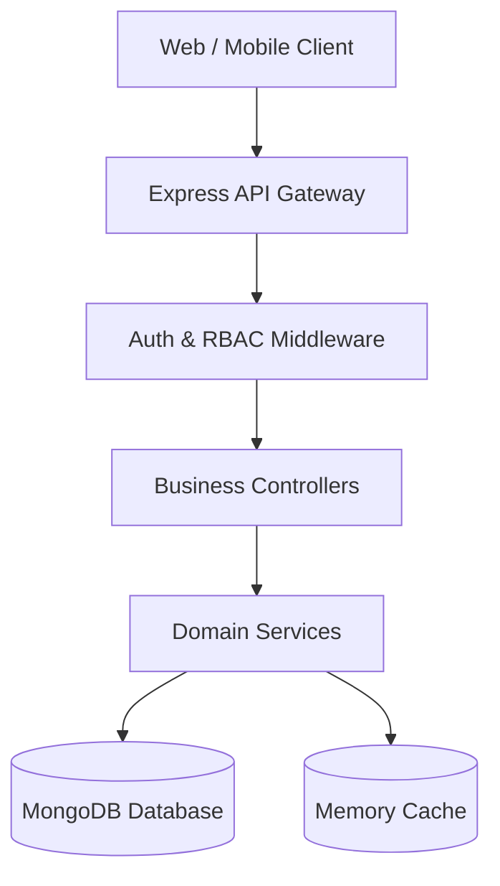

# System Architecture & Design

## Overview
FM-BLS is an interactive gamified learning system built on Node.js, Express, and MongoDB.

## Key Modules
1. **Authentication & Session**: Stateless JWT with sliding session refreshes.
2. **Gamification Engine**:
   - Streak tracking with StreakFreeze protection.
   - Dynamic XP calculations with streak and weekend multipliers.
   - Competitive leagues (Bronze, Silver, Gold, Diamond).
3. **Content Hierarchy**: Courses -> Lessons -> Quizzes.
